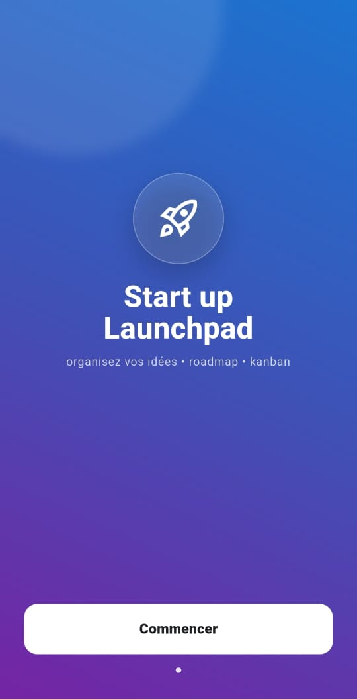
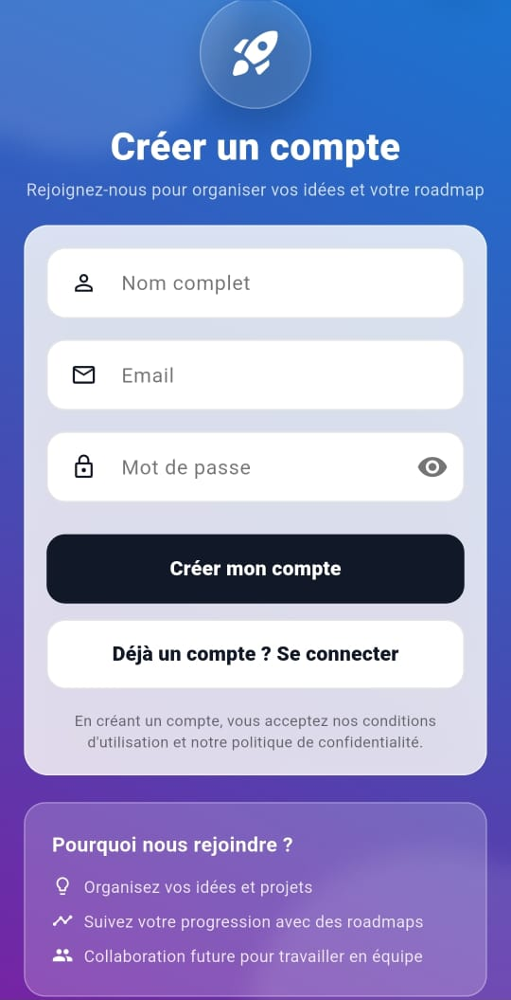
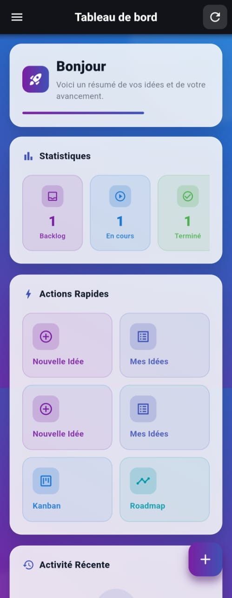

# Startup LaunchPad

<p align="center">
  
</p>

<h3 align="center">Turn ideas into structured action.</h3>

<p align="center">
  A mobile workspace to capture ideas, organize priorities, plan progress, and keep track of the journey from concept to completion.
</p>

<p align="center">
  
  
  
</p>

<p align="center">
  <a href="#overview">Overview</a> ·
  <a href="#product-capabilities">Features</a> ·
  <a href="#application-preview">Preview</a> ·
  <a href="#technical-overview">Technical Overview</a> ·
  <a href="#getting-started">Getting Started</a>
</p>

---

## Overview

Ideas are easy to generate, but turning them into concrete, organized work requires structure.

**Startup LaunchPad** was designed to address this gap by bringing idea management, prioritization, planning, and progress tracking into a single mobile application.

Rather than treating ideas as isolated notes, the application provides a workflow through which users can organize their thinking, define priorities, follow progress, and review their activity.

The result is a centralized workspace that connects the initial idea to its execution.

## Product Capabilities

The application is organized around a set of complementary capabilities that support the idea-management lifecycle.

### 01 — Idea Management

A structured space for capturing and organizing ideas.

- Create, view, update, and delete ideas.
- Classify ideas into categories.
- Assign High, Medium, or Low priority levels.
- Search and sort ideas.
- Filter by category and priority.
- Track the current status of each idea.

### 02 — Workflow Management

A Kanban board that makes the progress of ideas visible.

- Three workflow stages: Backlog, In Progress, and Completed.
- Drag-and-drop interactions to move ideas between stages.
- Status-based organization and activity counters.

### 03 — Planning & Roadmap

A planning view that helps users understand what needs attention and how work is progressing.

- Overall progress monitoring.
- Identification of high-priority pending ideas.
- Estimated deadlines.
- Progress breakdown by category.

### 04 — Dashboard & Progress Insights

A consolidated overview of the user's ideas and their current state.

- Total number of ideas.
- Completed ideas and overall progress.
- Distribution by status and priority.

### 05 — Activity Tracking

An activity history that allows users to review recorded actions and follow changes within the application.

### 06 — Personalization & Data Management

Features designed to make the application more adaptable and support data portability.

- Profile information management.
- Email and password updates.
- Dark mode and font-size customization.
- JSON export and import of ideas.
- Duplicate prevention during data import.

---

## Application Preview

A selection of application screens illustrating the user journey and its main interaction experience.

### Getting Started

<p align="center">
  
  &nbsp;&nbsp;&nbsp;
  
  &nbsp;&nbsp;&nbsp;
  
</p>

<p align="center">
  <sub>Application entry point and account access screens.</sub>
</p>

### Managing Ideas Through Kanban

<p align="center">
  
</p>

<p align="center">
  <sub>A visual workflow for organizing ideas and tracking their progress.</sub>
</p>

### Project Overview

<p align="center">
  
</p>

<p align="center">
  <sub>A centralized view of ideas and project progress.</sub>
</p>

---

## Technical Overview

Startup LaunchPad is built with Flutter and Dart, with SQLite providing local relational data persistence.

The codebase is organized into dedicated directories for data models, database management, repositories, application services, settings, UI pages, and reusable widgets.

This organization separates several application responsibilities and provides a clear starting point for future maintenance and evolution.

### Technology Stack

| Technology | Role |
|---|---|
| **Flutter** | Mobile application framework |
| **Dart** | Application programming language |
| **SQLite** | Local relational database |
| **sqflite** | SQLite database integration |
| **SharedPreferences** | Persistence of application preferences |
| **file_picker** | File selection for data import |
| **path / path_provider** | File and storage path utilities |

### Data Persistence

The application uses SQLite through `sqflite` for its local database.

The database includes dedicated tables for:

- Ideas
- Users
- Activity history

Application appearance preferences are stored separately using `SharedPreferences`.

### Code Organization

```text
lib/
├── database/       # Database initialization and management
├── models/         # Application data models
├── pages/          # Screens and user-facing features
├── repositories/   # Data access and persistence operations
├── services/       # Application-level services
├── settings/       # Application preferences and settings
├── widgets/        # Reusable UI components
└── main.dart       # Application entry point
```

---

## Getting Started

Follow these steps to run the project locally.

### Prerequisites

- Flutter SDK
- Dart SDK (`>=3.3.1 <4.0.0`)

### 1. Clone the repository

```bash
git clone https://github.com/YouSS3ra/Startup-LaunchPad.git
```

### 2. Navigate to the project directory

```bash
cd Startup-LaunchPad
```

### 3. Install dependencies

```bash
flutter pub get
```

### 4. Run the application

```bash
flutter run
```

---

## Project Status & Future Direction

Startup LaunchPad represents the first version of the application, bringing together the essential capabilities for organizing ideas and following their progress.

The project provides a foundation for future improvements, which may include:

- Further refinement of the user experience.
- Expanded planning and progress-tracking capabilities.
- Additional data-management features.
- Continued improvements to maintainability and application functionality.

These directions are potential evolutions rather than features currently claimed as implemented.

---

## Team

Startup LaunchPad was developed through collaborative work, with all team members contributing to the project.

| Contributor | GitHub Profile |
|---|---|
| **Youssra Hamidouche** | [@YouSS3ra](https://github.com/YouSS3ra) |
| **Najat Idraho** | [@najat-id-raho](https://github.com/najat-id-raho) |
| **Ouissal Jouhari** | [@OuissalJ](https://github.com/OuissalJ) |

---

## Feedback & Collaboration

This project is an opportunity to keep learning, building, and improving.

Suggestions, feedback, and ideas for future enhancements are welcome. Feel free to explore the repository and share your thoughts.

<p align="center">
  <strong>Startup LaunchPad</strong>
  <br />
  <sub>From an idea to a clearer path forward.</sub>
  <br /><br />
  Built with care by the Startup LaunchPad team.
</p>
